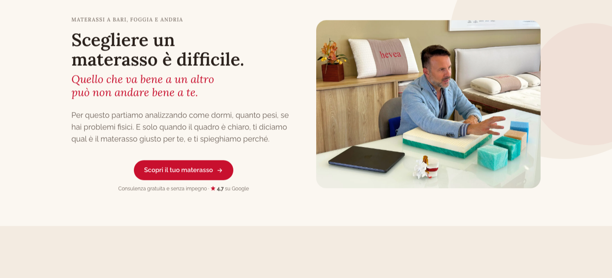

# Hevea Materassi

Sito web di Hevea Materassi, azienda pugliese di materassi su misura con tre showroom a Bari, Foggia e Andria.

**Online su [www.heveamaterassi.it](https://www.heveamaterassi.it)**



## Il progetto

Sono partito da un prototipo statico in HTML preparato dal designer (Tailwind caricato da CDN, Google Fonts, form non collegato a niente) e l'ho trasformato nel sito che è oggi in produzione: pagine in PHP con componenti condivisi, form di contatto funzionante, SEO tecnica e messa online su hosting condiviso. Il sito è pubblico e indicizzato su Google.

Il sito ha la home, la pagina catalogo, tre pagine di categoria (lattice, memory, molle), otto schede prodotto, il blog, le pagine legali e una 404 personalizzata.

## Cosa ho fatto

### Struttura e performance
- Pagine convertite in PHP con le parti ripetute in `partials/` (form di contatto, dati strutturati), senza framework.
- Tailwind passato dal CDN a una build compilata e minificata (~25 KB invece dello script runtime).
- Font Lora e Raleway ospitati in locale in `woff2`: nessuna richiesta a Google Fonts.
- Immagini convertite da PNG a WebP.

### Form di contatto
- **Frontend** ([`assets/js/form-consulenza.js`](assets/js/form-consulenza.js)): JavaScript vanilla, invio con `fetch`, stato di caricamento sul pulsante, messaggi di esito accessibili (`aria-live`) e costruiti con `textContent` per evitare XSS.
- **Backend** ([`send-form.php`](send-form.php)): validazione lato server di tutti i campi, whitelist per i valori delle select, honeypot anti-spam, risposte JSON con status code HTTP corretti (405, 422, 502).
- **Invio email** ([`mailer/smtp-mailer.php`](mailer/smtp-mailer.php)): client SMTP scritto da zero con i socket di PHP, senza librerie esterne. Gestisce SMTPS sulla 465 e STARTTLS sulla 587, autenticazione `AUTH LOGIN` e header codificati in UTF-8.
- Se il cliente sceglie di essere ricontattato su WhatsApp, l'email allo showroom contiene già il link `wa.me` con il messaggio precompilato.

### SEO
- Dati strutturati JSON-LD: `Organization`, un `FurnitureStore` per ciascuno dei tre showroom (indirizzo, coordinate, orari), `Product` per le schede, `BreadcrumbList` e `FAQPage`.
- Canonical su ogni pagina, `sitemap.xml`, `robots.txt` con regole esplicite anche per i crawler delle AI.
- `noindex` solo dove serve (pagine legali e blog ancora senza articoli).
- Pagina 404 personalizzata che risponde davvero con status 404.

### Sicurezza e configurazione server
- Credenziali SMTP fuori dal codice, in un `config.php` escluso dal repository (vedi [`config.example.php`](config.example.php)).
- `config.php` e la cartella `mailer/` non sono raggiungibili via URL ([`.htaccess`](.htaccess), [`mailer/.htaccess`](mailer/.htaccess)).
- Header di sicurezza: HSTS, `X-Frame-Options`, `X-Content-Type-Options`, `Referrer-Policy`.
- Redirect `/index.php` → `/` scritto con `THE_REQUEST`: un `RedirectMatch` andava in loop per via di `DirectoryIndex`.
- Directory listing disattivato.

### Deploy
Hosting condiviso Aruba senza accesso SSH: il deploy avviene tramite file manager, e dopo ogni rilascio verifico redirect, status code, header e meta tag con `curl`.

## Struttura

```
├── index.php, materassi*.php, <prodotto>.php   pagine del sito
├── partials/          componenti PHP condivisi (form, JSON-LD)
├── send-form.php      endpoint del form di contatto
├── mailer/            client SMTP
├── assets/
│   ├── css/           sorgente Tailwind e build compilata
│   ├── js/            logica del form
│   └── icons/         favicon e immagine Open Graph
├── fonts/             font self-hosted
├── *.webp             immagini
├── .htaccess          configurazione Apache
├── robots.txt
└── sitemap.xml
```

## Avvio in locale

Serve PHP 8 e Node.js.

```bash
npm install
npm run build:css                  # rigenera assets/css/tailwind.css
cp config.example.php config.php   # inserire le credenziali SMTP reali
php -S localhost:8000
```

Il server integrato di PHP non legge il `.htaccess`: redirect e header di sicurezza sono attivi solo su Apache.

## Note

Codice pubblicato con il consenso del cliente. Testi, fotografie e marchio sono di proprietà di Hevea Materassi e non sono riutilizzabili.
